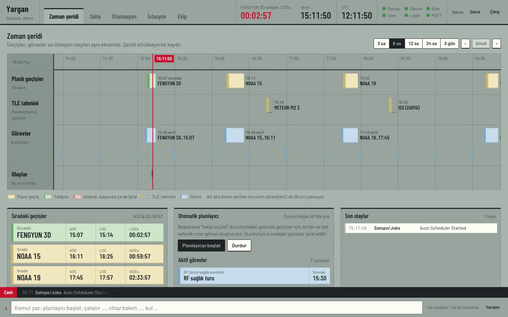
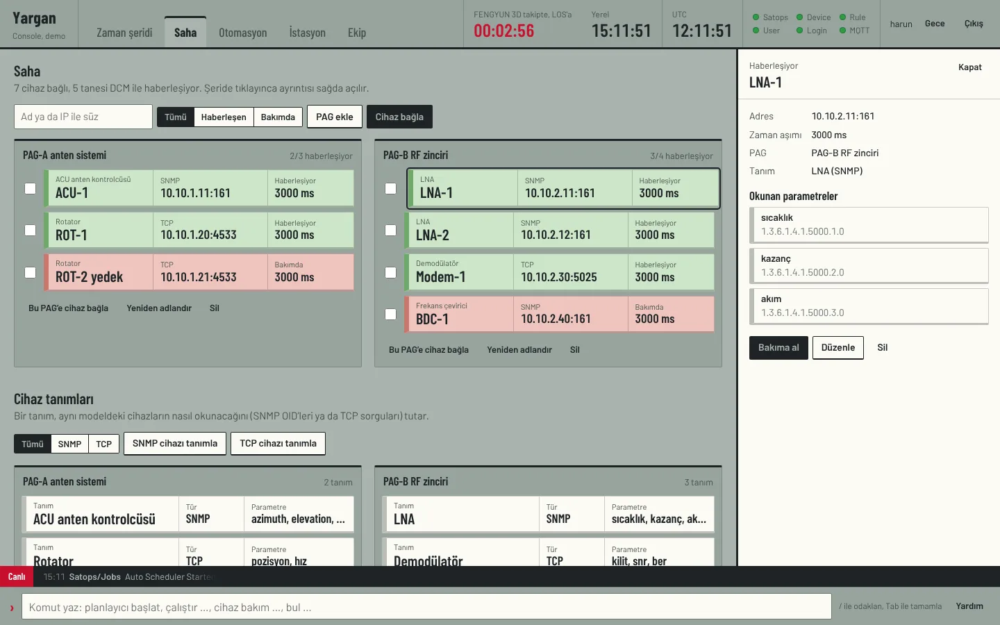
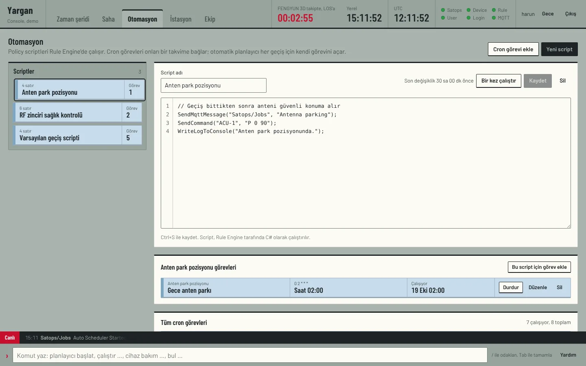
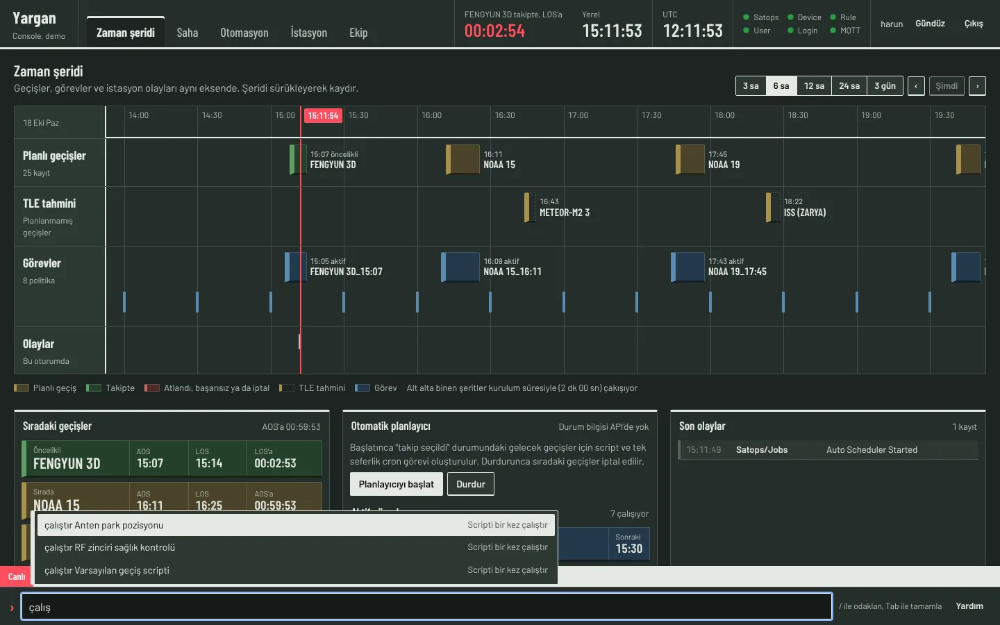

# Yargan Console

Yargan yer istasyonu için operatör konsolu. Login, User, Device, Rule ve Satops API'lerini ve
Mosquitto üzerinden gelen canlı olayları tek ekranda toplar.

Görsel dil hava trafik kontrolündeki uçuş şeritlerinden geliyor: gri-yeşil bir pano, üzerinde
renkli kâğıt şeritler ve tek bir kırmızı "şimdi" çizgisi. Renk hep bir anlam taşır:

| Şerit | Anlamı |
|---|---|
| Sarımsı (buff) | Geçiş |
| Mavi | Görev: cron politikası ya da script |
| Yeşil | Canlı: takipteki geçiş, haberleşen cihaz |
| Pembe | Sorun: atlanan/başarısız geçiş, bakımdaki cihaz |
| Kesikli | TLE'den hesaplanmış ama planlanmamış geçiş |



| | |
|---|---|
|  |  |
|  | |

Ekran görüntüleri demo modundan (`npm run dev:demo`) alınmıştır.

## Görünümler

- **Zaman şeridi:** planlı geçişler, TLE tahminleri, cron görevleri ve bu oturumdaki olaylar aynı
  zaman ekseninde. Sürükleyerek kaydırılır, 3 saat ile 3 gün arası pencere seçilir. Kurulum
  süresiyle çakışan geçişler alt alta biner. Altında sıradaki geçişler (geri sayımlı), otomatik
  planlayıcı ve son olaylar.
- **Saha:** PAG'ler raf gibi; içindeki cihazlar şerit. Tekli ya da toplu haberleşme başlatma /
  bakıma alma, cihaz bağlama, PAG yönetimi. Altında SNMP/TCP cihaz tanımları ve parametreleri.
- **Otomasyon:** policy script editörü (kaydet, bir kez çalıştır), scripte bağlı cron görevleri,
  tüm görevler; Türkçe cron açıklaması ve sonraki çalışma anları.
- **İstasyon:** konum, minimum elevasyon, kurulum süresi, hesaplama penceresi; adla TLE arama,
  checksum doğrulamalı TLE yapıştırma; hesaplanan geçişleri seçip planlama, elle geçiş ekleme.
- **Ekip:** kullanıcılar.

Her şeride tıklayınca sağda ayrıntı paneli açılır ve o kayıtla ilgili işlemler oradadır.

## Komut satırı

Alttaki `›` satırı her ekrandan çalışır (`/` ya da `Ctrl+K` ile odaklanır, Tab tamamlar):

```
planlayıcı başlat          planlayıcı durdur
çalıştır <script>          görev başlat|durdur <ad>
cihaz bakım|başlat <ad>    bul <cihaz, script, görev ya da uydu>
git saha                   şimdi       yenile       tema       yardım
```

`Alt+1…5` görünümler arasında geçer, `Esc` ayrıntı panelini kapatır, `↑` komut geçmişini açar.

## Laptopta hepsini Docker ile çalıştırmak

Repo kökünde:

```bash
docker compose -f compose.laptop.yml up -d --build
```

- Arayüz: http://localhost:8080
- İlk giriş: `operator` / `yargan123` (`SEED_USER`, `SEED_PASSWORD` ile değiştirilebilir)
- API'lerin Scalar sayfaları: http://localhost:5098/scalar (Device), 5165 (Rule), 5131 (Satops),
  5050 (User), 5002 (Login)

Compose şunları açar: Postgres, Mongo (kullanıcı logları), Mosquitto (1883 + websocket 9001),
şemayı EF Core migration'larıyla kuran tek seferlik `migrator`, beş API, ilk kullanıcıyı açan
tek seferlik `seed` ve bu arayüz. Container saatleri `Europe/Istanbul`, çünkü backend saatleri
saat dilimi olmadan yerel saat olarak saklıyor.

Host portları `launchSettings.json`'daki http profilleriyle aynı. Bir API üzerinde çalışırken onu
durdurup (`docker compose -f compose.laptop.yml stop satopsapi`) Visual Studio ya da `dotnet run`
ile çalıştırabilirsin; ancak arayüz container içinden servis adına gittiği için o durumda
`console` servisinde ilgili adresi `http://host.docker.internal:5131` yap.

## Geliştirme

Node.js 20+ gerekir.

```bash
npm install
npm run dev:demo   # API'siz, tarayıcı içi örnek verilerle (http://localhost:5174)
npm run dev        # API'ler localhost'taki http profillerinde çalışırken
```

Geliştirme sunucusu `/svc/<servis>` isteklerini ilgili API'ye, `/mqtt`'yi Mosquitto'nun
websocket dinleyicisine iletir; Docker'da aynı işi nginx yapar. Hedefler `DEVICE_API_URL`,
`RULE_API_URL`, `SATOPS_API_URL`, `USER_API_URL`, `LOGIN_API_URL`, `MQTT_WS_URL` ortam
değişkenleriyle değiştirilebilir.

API'siz bir demo imajı da üretilebilir:

```bash
docker build --build-arg DEMO=true -t yargan-console-demo src/YarganConsole
docker run -p 8081:80 yargan-console-demo
```

## Backend notları

- Device rotaları ve Satops → Rule çağrıları PR #2'deki düzeltmelere dayanıyor; bu branch onun
  üzerine kurulu.
- API'de olmayan şeyler arayüzde de yok: geçiş güncelleme/silme, planlayıcının açık mı kapalı mı
  olduğunu sorgulama, alarm uçları (AlarmService var ama controller'ı yok), rol yönetimi.
  Planlayıcı için arayüz son verilen komutu tarayıcıda hatırlıyor.
- `SatellitePassService.AddPassesFromTle` eklenecek listeyi hiç doldurmadığı için arayüz geçiş
  planlamada `getpassbyrange` (toplu ekleme) ucunu kullanıyor.
- `AutoStartOrStop` döngüsünde `willBeSchedulePasses[i + 1]` son elemanda dizi dışına çıkıyor;
  planlanacak tek geçiş bile olsa istek 500 dönebilir.
